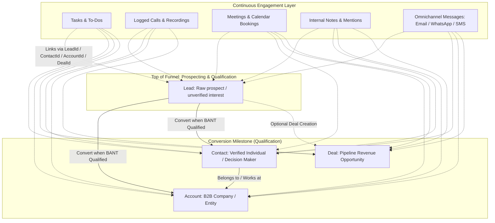
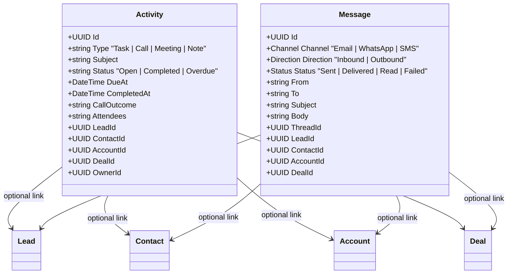

# MindLift CRM Core Architecture: Leads, Contacts, Accounts & Engagements

This document provides a complete breakdown of the four foundational pillars of **MindLift CRM**—**Leads**, **Contacts**, **Accounts**, and **Engagements** (Activities & Omnichannel Communications). It bridges the technical Database Architecture with real-world Business Operations, Lifecycle Timelines, and ROI.

---

## 1. High-Level Entity Relationship & Lifecycle Flow

---

## 2. Lead

### A. Business POV (Purpose & Strategy)
* **What is a Lead?** A temporary, unvetted entity representing a person or organization that has shown preliminary interest or whose contact details were acquired, but where business viability (BANT: Budget, Authority, Need, Timeline) has **not yet been verified**.
* **Why Separate Leads from Contacts & Accounts?** 
  - Protects your core customer master data from low-quality noise, spam, and cold lists.
  - Allows aggressive marketing scoring, automated qualification, and SDR (Sales Development Representative) triage without cluttering company accounts.
* **Key KPI Metrics:** Speed to Lead (SLA < 24h), Lead-to-Opportunity Conversion Rate, Cost Per Qualified Lead (CPQL), Bounce Rate.

### B. When is it Used? (Timing & Lifecycle Triggers)
| Trigger Event | Timing | Action in CRM |
| :--- | :--- | :--- |
| **Inbound Form Fill** | Immediately upon web form submission | Webhook/API inserts Lead with `Source="Website"`, `Status="New"`, runs auto-assignment rules. |
| **Bulk Trade Show / Outbound List** | Post-event batch ingestion | Excel/CSV bulk import with `CompanyName`, `Email`, `Phone`, `Address`, `City`, `State`. |
| **Outreach & Triage** | Minutes to hours after arrival | SDR makes first contact; system stamps `FirstContactedAt` (SLA tracking). |
| **Qualification (BANT Met)** | Within 2–7 business days | Lead is **Converted** into 1 Account + 1 Contact (+ optional Deal). Lead record is marked `ConvertedAt` and locked. |
| **Disqualification** | Immediate upon failed validation | Marked `Status="Disqualified"` with `DisqualifyReason` (e.g., *"No budget"*, *"Competitor"*, *"Bad contact data"*). |

### C. Database Architecture (DB POV)
* **Table:** `leads` (inherits `TenantEntity`)
* **Multi-Tenancy & Security:** Multi-tenant isolated via `TenantId`, audited via `[Audited]` interceptor, row-level ownership via `OwnerId`.
* **Schema Highlights:**
  - Primary Identity: `Id` (`uuid`), `TenantId` (`uuid`), `FirstName` (`varchar(100)`), `LastName` (`varchar(100)`), `CompanyName` (`varchar(200)`).
  - Normalization & Dedup: `NormalizedEmail` (lowercase/trimmed), `NormalizedPhone` (E.164 clean digits with `+`).
  - Physical Address: `Address`, `City`, `State` (for territory assignment and regional routing).
  - Status & Workflow: `Status` (default: `"new"`, picklist: `"contacted"`, `"qualified"`, `"disqualified"`), `DisqualifyReason` (`varchar(100)`).
  - Scoring & SLA: `Score` (`integer`, 0–100+), `ScoreGrade` (`varchar(20)`: `"Hot"`, `"Warm"`, `"Cold"`), `LastScoredAt` (`timestamp`), `AssignedAt`, `FirstContactedAt`.
  - Conversion Tracking: `ConvertedAt`, `ConvertedById`, `ConvertedContactId`, `ConvertedAccountId`, `ConvertedDealId`.
  - Extensibility: `CustomFields` (`jsonb` document), `Tags` (`text[]`).

---

## 3. Account

### A. Business POV (Purpose & Strategy)
* **What is an Account?** The legal or commercial organization (B2B Company, Enterprise, Institution, Subsidiary, or Partner) with which you conduct or intend to conduct business.
* **Why it Matters:**
  - Provides a single, 360-degree consolidated view of corporate relationships, revenue rollups, multiple branch locations, and aggregate contract values.
  - Supports parent-subsidiary enterprise hierarchies (e.g., *Alphabet Inc.* -> *Google LLC*).
* **Key KPI Metrics:** Account Lifetime Value (LTV), Annual Recurring Revenue (ARR), Expansion Revenue, Net Revenue Retention (NRR), Account Penetration (Number of active deals & contacts per account).

### B. When is it Used? (Timing & Lifecycle Triggers)
| Trigger Event | Timing | Action in CRM |
| :--- | :--- | :--- |
| **Lead Conversion** | Moment a prospect qualifies | Account is generated automatically from `Lead.CompanyName`. |
| **Account-Based Marketing (ABM)** | Strategic prospecting phase | Account is pre-created by Account Executives (AE) with target tier, industry, and hierarchy. |
| **Mergers & Acquisitions / Expansion** | Long-term account growth | Linked to parent via `ParentAccountId` to track holding companies vs operating subsidiaries. |
| **ERP / Billing Synchronization** | Post-sale quote signing | Account syncs to ERP/Accounting as the primary Invoicing Customer Entity. |

### C. Database Architecture (DB POV)
* **Table:** `accounts` (inherits `TenantEntity`)
* **Multi-Tenancy & Security:** Isolated by `TenantId`, audited via `[Audited]`, owned by `OwnerId`.
* **Schema Highlights:**
  - Primary Identity: `Id` (`uuid`), `TenantId` (`uuid`), `Name` (`varchar(255)`, indexed).
  - Business Profile: `Website` (`varchar(255)`), `Phone` (`varchar(50)`), `Industry` (`varchar(100)`), `Description` (`text`).
  - Enterprise Hierarchy: `ParentAccountId` (`uuid`, self-referencing foreign key `FK_accounts_accounts_ParentAccountId`).
  - Governance: `OwnerId` (`uuid` pointing to `users.id`), `IsSample` (`boolean`).
  - Extensibility: `CustomFields` (`jsonb`).

---

## 4. Contact

### A. Business POV (Purpose & Strategy)
* **What is a Contact?** An individual human being with verified identity, job role, and personal communication history who belongs to an **Account**.
* **Why it Matters:**
  - In B2B sales, companies don't buy products—people inside companies buy products.
  - Tracks individual champions, economic buyers, legal approvers, gatekeepers, and end-users within an account.
  - Serves as the login identity for the **MindLift Customer Portal**.
* **Key KPI Metrics:** Contact Engagement Score, Net Promoter Score (NPS), Champion Churn Risk, Portal Adoption Rate.

### B. When is it Used? (Timing & Lifecycle Triggers)
| Trigger Event | Timing | Action in CRM |
| :--- | :--- | :--- |
| **Lead Conversion** | Qualification milestone | The individual prospect is converted into a verified `Contact` linked to the newly created `Account`. |
| **Meeting Introductions** | Mid-pipeline discovery | Sales rep learns of other stakeholders (e.g., CFO, CTO) and adds new Contacts under the existing Account. |
| **Customer Portal Access** | Onboarding / Post-sale | Contact is invited to the Customer Portal (`/{slug}/login`) to view invoices, sign quotes, and track tickets. |
| **Quote E-Signature & Invoicing** | Closing phase | Contact is chosen as the signee / recipient for CPQ proposals and invoices. |

### C. Database Architecture (DB POV)
* **Table:** `contacts` (inherits `TenantEntity`)
* **Multi-Tenancy & Security:** Multi-tenant isolated via `TenantId`, audited via `[Audited]`.
* **Schema Highlights:**
  - Primary Identity: `Id` (`uuid`), `TenantId` (`uuid`), `FirstName`, `LastName`, `JobTitle` (`varchar(100)`).
  - Direct Communication: `Email`, `Phone`, `NormalizedEmail`, `NormalizedPhone` (indexed for instant deduplication).
  - Organizational Relationship: `AccountId` (`uuid`, foreign key referencing `accounts.id`).
  - Categorization: `Type` (picklist: `"Customer"`, `"Prospect"`, `"Vendor"`, `"Partner"`).
  - Ownership: `OwnerId` (`uuid` referencing `users.id`).
  - Extensibility: `CustomFields` (`jsonb`).

---

## 5. Engagements: Activities & Omnichannel Communication

Engagements in MindLift are split into two complementary operational layers:
1. **Activities**: Internal execution (Tasks, Calls, Meetings, Notes).
2. **Omnichannel Communication**: External customer dialogue (Email, WhatsApp, SMS).

### A. Business POV (Purpose & Strategy)
* **What are Engagements?** The chronological, unified history of every touchpoint, commitment, conversation, and milestone between your staff and the customer.
* **Why it Matters:**
  - Eliminates reliance on salesperson memory and prevents deal stall due to forgotten follow-ups.
  - Guarantees seamless account handoffs (e.g., when an SDR hands off to an AE, or an AE hands off to Customer Success).
  - Provides objective sales activity analytics (calls made vs pipeline generated vs deals won).

### B. When is it Used? (Timing & Lifecycle Triggers)
| Engagement Type | Timing / Trigger | Business Application |
| :--- | :--- | :--- |
| **Task** | Set during pipeline movement (e.g., *"Send revised MSA by Friday 3 PM"*) | Drives day-to-day salesperson checklist, SLA alerts, and calendar notifications. |
| **Call** | Immediate upon initiating or finishing phone call | Records call direction (Inbound/Outbound), duration, recording URL, and `CallOutcome` (*"Left Voicemail"*, *"Interested"*, *"Gatekeeper"*). |
| **Meeting** | Scheduled booking or public calendar invitation | Syncs calendar appointments, attendees list, room/video location, and triggers .ics calendar updates. |
| **Note & Mention** | During internal reviews or deal strategy | Sticky context on a record (e.g., *"Competitor X offered 15% discount; match it"*), supports `@mentions`. |
| **Omnichannel Message** | Two-way external conversations | Unified inbox for Email, WhatsApp, and SMS directly in the CRM timeline. |

### C. Database Architecture (DB POV)
#### 1. Activities (`activities`)
* **Table:** `activities` (inherits `TenantEntity`, implements `IOwnedEntity`)
* **Polymorphic Parent Links:**
  - `LeadId` (`uuid`, nullable FK): Attached when engaging a prospect.
  - `ContactId` (`uuid`, nullable FK): Attached to a verified person.
  - `AccountId` (`uuid`, nullable FK): Attached to a company.
  - `DealId` (`uuid`, nullable FK): Attached to a live revenue opportunity.
* **Execution Fields:**
  - `Type`: `"Task"`, `"Call"`, `"Meeting"`, `"Note"`.
  - `Subject` (`varchar(255)`), `Status` (`"Open"`, `"Completed"`), `Priority` (`"Low"`, `"Normal"`, `"High"`).
  - Timing: `DueAt`, `EndAt`, `DurationMinutes`, `CompletedAt`, `CompletedById`.
  - Notifications: `ReminderMinutes`, `ReminderSentAt`, `OverdueNotifiedAt`.
  - Meetings: `Location`, `Attendees` (`json` array of emails), `InvitationsSentAt`.
  - Recursive Follow-ups: `ParentActivityId` (supports *"Complete and create follow-up"* chains).

#### 2. Messages (`messages`)
* **Table:** `messages` (inherits `TenantEntity`)
* **Schema Highlights:**
  - `Channel`: `Email` (0), `WhatsApp` (1), `Sms` (2).
  - `Direction`: `Inbound` (0), `Outbound` (1).
  - `Status`: `Draft`, `Queued`, `Sent`, `Delivered`, `Read`, `Failed`.
  - Dialogue State: `From`, `To`, `Subject`, `Body` (`text`), `ThreadId` (`uuid` grouping conversation chains).
  - Context Links: `LeadId`, `ContactId`, `AccountId`, `DealId`, `SentByUserId`.
  - Deliverability Tracking: `ExternalMessageId` (Twilio / SendGrid / Meta API IDs), `DeliveredAt`, `ReadAt`.

---

## 6. Comprehensive Comparison & Summary Table

| Dimension | **Lead** | **Account** | **Contact** | **Engagement** |
| :--- | :--- | :--- | :--- | :--- |
| **Core Entity Type** | Ephemeral Prospect | Corporate Organization | Individual Person | Interaction & Work Item |
| **Database Table** | `leads` | `accounts` | `contacts` | `activities` & `messages` |
| **Primary Identifier** | Name, Company, Email, Phone | Company Legal Name, Domain | Person Name, Title, Work Email | Type, Subject, Timestamp |
| **Who Owns It?** | SDR / Inbound Rep | Account Exec / CS Director | Account Exec / CS Rep | Activity Creator / Assignee |
| **Primary Business Goal** | Fast Qualification & SLA | Account LTV & Retention | Personal Relationship & Buy-in | Accountability & Conversion Velocity |
| **Typical Lifespan** | 24 Hours to 30 Days | Years to Decades (Permanent) | Years (or job tenure) | Transient Tasks / Permanent History |
| **Database Conversion** | Converts into Account + Contact | Never converted (receives leads) | Never converted (receives leads) | Attached polymorphically to any entity |
| **Audit & Governance** | Audited, GDPR Disqualify | Audited, Hierarchies, History | Audited, GDPR Consent, Portal Auth | Audited, Overdue Alerts, Read Receipts |
